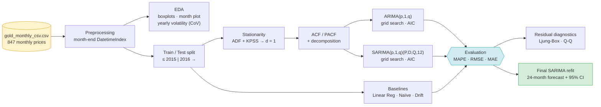

<div align="center">

# 🥇 Gold Price Forecasting

### ARIMA · SARIMA · Walk-forward validation on 70 years of monthly data

*From stationarity tests to a 24-month forecast with confidence intervals — and an honest look at what statistical models can and cannot predict.*

<br>


<br>

[📊 Results](#-results) · [🏗️ Architecture](#️-architecture) · [🚀 Quick Start](#-quick-start) · [🔍 Key Takeaways](#-key-takeaways)

</div>

---

## 📑 Table of Contents

- [Overview](#-overview)
- [Architecture](#️-architecture)
- [Dataset & Data Dictionary](#-dataset--data-dictionary)
- [Project Structure](#-project-structure)
- [Methodology](#-methodology)
- [Results](#-results)
- [Key Takeaways](#-key-takeaways)
- [Quick Start](#-quick-start)
- [Limitations & Next Steps](#-limitations--next-steps)
- [Author](#-author)

---

## 🎯 Overview

This project forecasts the **monthly price of gold** (Jan 1950 → Jul 2020, 847 observations) with classical time-series models and evaluates them rigorously against baselines.

What makes it more than "fit a model and plot it":

- ✅ **Formal stationarity testing** (ADF + KPSS) to justify differencing
- ✅ **ACF / PACF + seasonal decomposition** to guide model orders
- ✅ **Automated grid search on AIC** for both ARIMA and SARIMA
- ✅ **Residual diagnostics** (Ljung-Box, Q-Q plot, correlogram)
- ✅ **Two evaluation protocols**: 55-month multi-step *and* rolling one-step-ahead
- ✅ **Honest benchmarking** against Linear Regression, Naïve and Drift baselines
- ✅ **24-month forecast** with 95 % confidence intervals

---

## 🏗️ Architecture



---

## 📦 Dataset & Data Dictionary

Monthly gold prices from **January 1950 to July 2020** (847 rows, no missing values).

| Column | Type | Description |
|--------|------|-------------|
| `Date` | `datetime` | Original date column (replaced by a month-end index in the notebook) |
| `Price` | `float` | Monthly gold price in USD per troy ounce (nominal) |
| `Month` | `DatetimeIndex` | Month-end index built with `pd.date_range(freq='M')` |
| `Mean` | `float` | Yearly average price *(derived, EDA)* |
| `Std` | `float` | Yearly standard deviation *(derived, EDA)* |
| `Cov_pct` | `float` | Coefficient of variation `Std / Mean × 100` — yearly volatility *(derived, EDA)* |
| `time` | `int` | Time-step counter used by the Linear Regression baseline *(derived)* |

**Split:** training = 1950 → 2015 (792 months) · test = 2016 → Jul 2020 (55 months).

---

## 📁 Project Structure

| Path | Description |
|------|-------------|
| `forecast_arima_sarima.ipynb` | Main notebook: EDA → baselines → ARIMA → SARIMA → evaluation → final forecast |
| `gold_monthly_csv.csv` | Input dataset (`Date`, `Price`) |
| `requirements.txt` | Pinned Python dependencies |
| `images/acf_pacf.png` | ACF / PACF of the differenced training series |
| `images/decomposition.png` | Trend / seasonal / residual decomposition |
| `images/arima_forecast.png` | ARIMA multi-step forecast with 95 % CI |
| `images/sarima_forecast.png` | SARIMA multi-step forecast with 95 % CI |
| `images/sarima_diagnostics.png` | Residual diagnostics |
| `images/model_comparison.png` | All models vs. actuals (multi-step and one-step) |
| `images/mape_comparison.png` | MAPE bar chart |
| `images/future_forecast.png` | 24-month out-of-sample forecast |
| `README.md` | This file |

---

## 🔬 Methodology

### 1 · Stationarity

| Series | ADF p-value | KPSS p-value | Verdict |
|--------|:-----------:|:------------:|:-------:|
| Price (level) | 0.787 | 0.010 | ❌ Non-stationary |
| Price (1st difference) | < 0.001 | 0.100 | ✅ Stationary |

→ One difference is required: **d = 1**.

<p align="center"></p>

### 2 · Model selection

Both models are selected by exhaustive grid search on **AIC** (training data only — no test leakage).

```python
# ARIMA(p, 1, q): p, q ∈ {0..3}
for p, q in itertools.product(range(4), range(4)):
    fit = ARIMA(y_train, order=(p, 1, q)).fit()

# SARIMA(p, 1, q)(P, D, Q, 12): monthly seasonality
for p, q, P, D, Q in itertools.product(range(3), range(3), range(2), range(2), range(2)):
    fit = SARIMAX(y_train, order=(p, 1, q), seasonal_order=(P, D, Q, 12)).fit(disp=False)
```

| Model | Selected order | AIC |
|-------|---------------|:---:|
| ARIMA | `(1, 1, 3)` | 7205.3 |
| SARIMA | `(1, 1, 1)(1, 1, 1, 12)` | **7149.8** |

SARIMA's AIC is ~55 points lower, so the seasonal terms are statistically supported by the training data.

### 3 · Two evaluation protocols

```python
# Multi-step: forecast all 55 test months from the end of training (hard)
pred = sarima_fit.get_forecast(steps=len(y_test)).predicted_mean

# Rolling one-step-ahead: parameters fixed, new observation appended each month
roll = sarima_fit.extend(y_test).get_prediction(start=y_test.index[0]).predicted_mean
```

---

## 📊 Results

### Multi-step forecast (55 months ahead)

| Model | MAPE (%) | RMSE | MAE |
|-------|:--------:|:----:|:---:|
| 🥇 **SARIMA (1,1,1)(1,1,1,12)** | **16.03** | **267.2** | **226.7** |
| Drift | 16.15 | 267.6 | 228.0 |
| Naïve (last value) | 18.81 | 306.9 | 264.9 |
| ARIMA (1,1,3) | 22.53 | 356.5 | 315.3 |
| Linear Regression (trend) | 29.78 | 431.8 | 408.6 |

### Rolling one-step-ahead

| Model | MAPE (%) | RMSE | MAE |
|-------|:--------:|:----:|:---:|
| 🥇 **SARIMA (1,1,1)(1,1,1,12)** | **2.21** | **40.5** | **29.8** |
| ARIMA (1,1,3) | 2.32 | 41.3 | 31.2 |
| Naïve (last value) | 2.40 | 42.7 | 32.5 |

<p align="center"></p>

### 24-month forecast (Aug 2020 →)

<p align="center"></p>

---

## 🔍 Key Takeaways

1. **SARIMA is the best model on both protocols**, cutting the Linear Regression baseline's error from 29.8 % to 16.0 % MAPE on the long horizon, and reaching **2.2 % MAPE** one month ahead.
2. **The margin over simple baselines is small.** SARIMA beats the Drift baseline by only 0.12 MAPE points over 55 months and the Naïve baseline by ~0.2 points one month ahead. Gold behaves close to a random walk with drift — beating it is hard, and this project reports that plainly instead of overselling.
3. **Long-horizon forecasting is fundamentally limited.** The 2016 → 2020 rally is a structural move that no model trained on data up to 2015 can anticipate; all long-horizon forecasts stay flat while the real price climbs.
4. **ARIMA(1,1,3) underperforms the Naïve baseline on the long horizon** (22.5 % vs 18.8 %): lowest AIC on the training set does not guarantee the best out-of-sample forecast — a good reminder to always validate on held-out data.
5. **Residuals are not perfectly white.** SARIMA's Ljung-Box p-values (0.024 at lag 12, 0.013 at lag 24) indicate leftover autocorrelation, likely caused by changing volatility — gold was price-fixed before 1971 and free-floating afterwards.

<p align="center"></p>

---

## 🚀 Quick Start

```bash
# 1. Clone
git clone https://github.com/YOUR_USERNAME/gold-price-forecasting.git
cd gold-price-forecasting

# 2. Create an environment
python -m venv .venv
source .venv/bin/activate        # Windows: .venv\Scripts\activate

# 3. Install dependencies
pip install -r requirements.txt

# 4. Launch the notebook
jupyter notebook forecast_arima_sarima.ipynb
```

> ⚠️ **pandas version:** the EDA cells use the legacy frequency aliases `'M'`, `'Y'`, `'Q'`, which were removed in pandas 3. The requirements pin `pandas<3`.

**Minimal usage example:**

```python
from statsmodels.tsa.statespace.sarimax import SARIMAX

model = SARIMAX(df["Price"], order=(1, 1, 1), seasonal_order=(1, 1, 1, 12)).fit(disp=False)
forecast = model.get_forecast(steps=24)

print(forecast.predicted_mean.head())
print(forecast.conf_int(alpha=0.05).head())
```

---

## 🧭 Limitations & Next Steps

- [ ] Model **volatility** explicitly (ARIMA-GARCH) to fix the autocorrelated residuals
- [ ] Restrict training to the **post-1971 free-float era** and compare
- [ ] Add exogenous drivers with **SARIMAX** (USD index, real interest rates, inflation)
- [ ] Benchmark against **Prophet**, **XGBoost** with lag features, and an **LSTM**
- [ ] Replace the single split with **expanding-window cross-validation**
- [ ] Wrap the final model in a small **Streamlit** dashboard

---

## 👤 Author

**Hamza** — Computer Science student, École Supérieure de Technologie – Safi · Data Science & Analytics

[](https://github.com/YOUR_USERNAME)
[](https://www.linkedin.com/in/YOUR_PROFILE)

<div align="center">

⭐ *If you found this project useful, consider giving it a star!* ⭐

</div>
